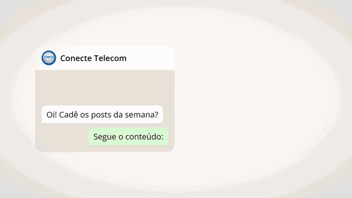
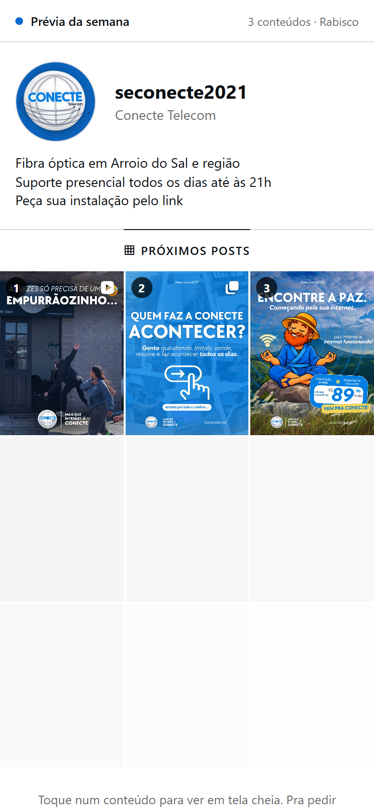
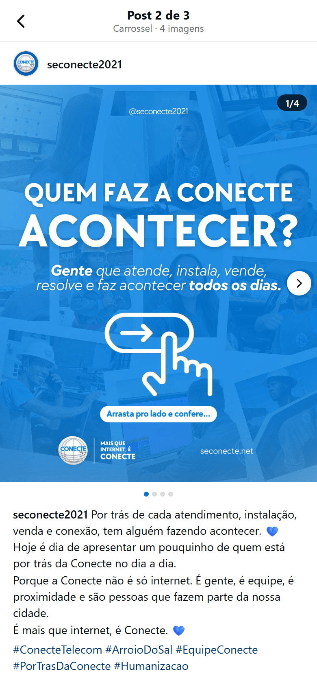
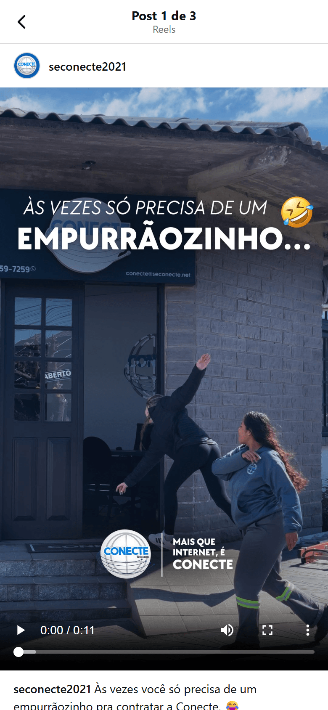
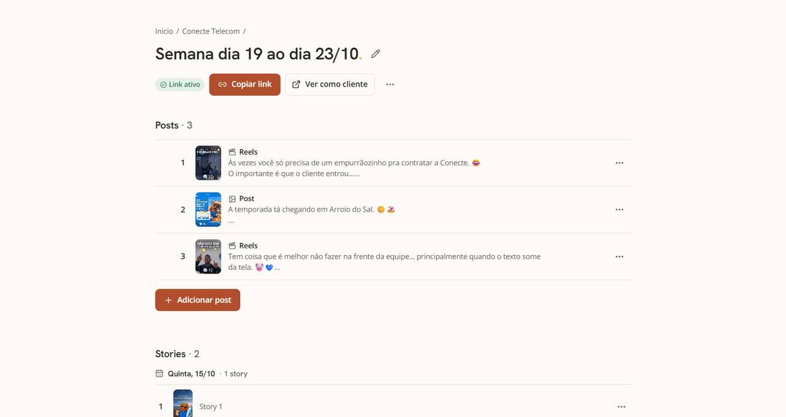
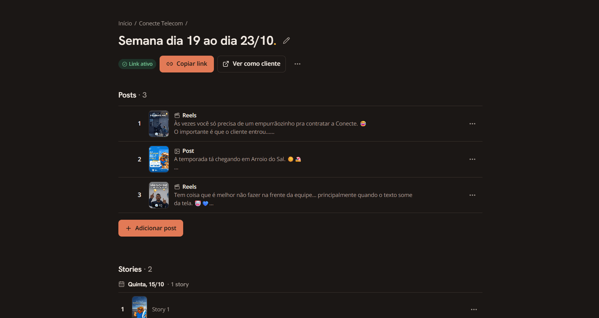
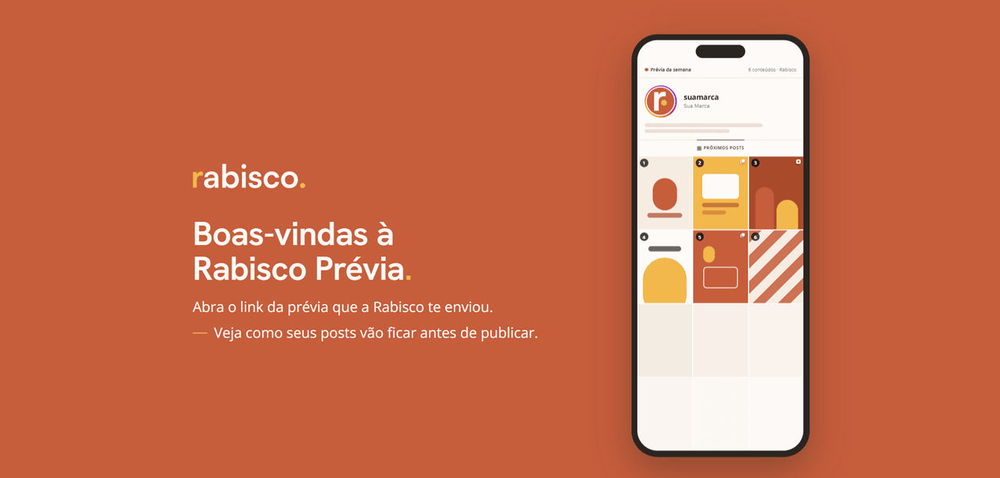
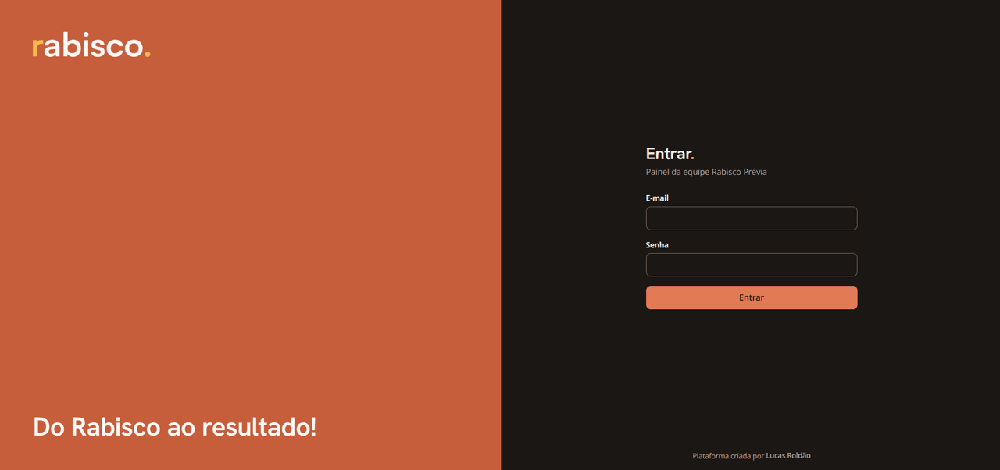
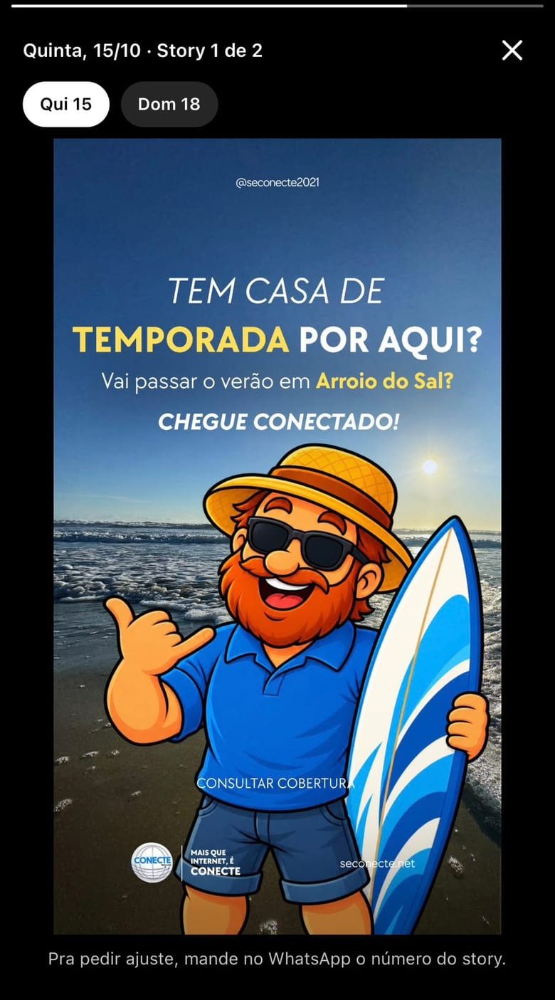

# 📱 Rabisco Prévia

> Ferramenta da agência Rabisco para apresentar o conteúdo da semana aos clientes por link, com cara de perfil do Instagram: o cliente vê como o post vai ficar no feed antes de ele ser publicado.

[](https://rabisco-previa.vercel.app/p/demo)
[](https://nextjs.org)
[](https://www.typescriptlang.org)
[](https://tailwindcss.com)
[](https://supabase.com)
[](https://vercel.com)

<p align="center">
  
</p>

<p align="center">
  
  
  
</p>

<p align="center">
  
  
</p>

<details>
<summary>Mais telas</summary>
<br>
<p align="center">
  
  
</p>
<p align="center">
  
</p>
</details>

> 📂 **Repositório público (portfólio).** O exemplo usa a marca e o conteúdo da **Conecte Telecom**, com autorização da empresa. Dados de outros clientes da Rabisco não entram aqui.

---

## 📖 Sobre o projeto

A Rabisco é uma agência de marketing digital e design da qual faço parte. Até aqui, o conteúdo da semana ia para o cliente numa pasta zipada pelo WhatsApp: ele não via como o post ficaria no feed, a legenda chegava separada da arte e o feedback ("muda aquele azul") não dizia de qual post estava falando.

A Prévia resolve isso com **um link por semana**. O cliente abre no celular, vê um perfil parecido com o do Instagram, com o grid dos próximos posts numerados, e toca em cada um para ver a arte, o carrossel, o Reels e a legenda. O ajuste continua pelo WhatsApp, por print, citando o número do post.

É **só visualização**, de propósito: sem login para o cliente, sem comentários e sem aprovação dentro do app. A equipe monta tudo por um painel próprio.

## 📈 Em números

| | |
|---|---|
| Do primeiro commit ao painel com identidade no ar | 13/10 → 14/10/2026 |
| Vídeo comprimido no navegador (caso real, 43 s do CapCut) | 57,4 MB → 6,7 MB |
| Vídeo HEVC de 60 s (teste) | 71,6 MB → 8,8 MB |
| Redesenho completo do painel | tela do cliente preservada: na comparação de capturas (7 telas × claro e escuro), só o rodapé da assinatura mudou |
| Acesso público direto ao banco | nenhum, conferido por script com a chave pública |
| Cores do painel e das páginas públicas | contraste conferido por script (WCAG AA) |
| Testes | 41 de unidade + teste de ponta a ponta com Playwright no Supabase real |
| Custo de banco e arquivos | R$ 0 (plano gratuito do Supabase) |

## ✨ Funcionalidades

**Tela do cliente (`/p/<token>`, sem login)**
- 📱 **Grid 3:4 numerado**, com silhuetas esmaecidas no fim, como num perfil de verdade
- 🖼️ **Visualizador em tela cheia** para post, carrossel (com swipe) e Reels, com a legenda e as hashtags
- ⭕ **Stories** da semana: anel colorido que fica cinza depois de visto, balão de dica na primeira visita e visualizador 9:16 com avanço automático
- 🌗 Segue o **tema do aparelho** (claro ou escuro)
- 🔗 **Link por token**, que a equipe pode desativar, reativar ou regenerar

**Painel da equipe (`/admin`)**
- 👥 Clientes e apresentações por semana
- 🧩 Novo post com **arrastar e soltar**, prévia dos arquivos e barra de progresso real
- 🎞️ **Compressão de vídeo no navegador** (ffmpeg.wasm), com capa automática
- ↕️ **Reordenar** posts arrastando (também pelo teclado)
- 📦 **Medidor de armazenamento** e limpeza em lote das semanas antigas
- 🎨 Tema **Claro, Escuro ou Sistema**, barra lateral que vira gaveta no celular, troca de senha

---

## 🧭 Decisões que valem o registro

- **Vídeo do iPhone não cabia no plano gratuito** (HEVC, quase sempre acima de 50 MB). Decidi comprimir **no navegador de quem monta a semana**, com ffmpeg.wasm, sem custo de servidor. O Turbopack não empacota o worker do ffmpeg, então ele é carregado do CDN com versão fixa e **hash SHA-384 conferido** antes do uso.
- **Chave pública errada aparecia como "senha incorreta".** A causa real era um 401 do Supabase. O login agora separa credencial inválida de erro de configuração e registra `status`, `code` e `name` no servidor, sem nenhum dado sensível.
- **Redesenhar o painel sem tocar na tela do cliente.** Tokens de tema isolados no painel e nas páginas públicas, e uma comparação de capturas antes e depois para provar o isolamento.
- **Modais abrindo no canto da tela.** O reset do Tailwind zerava a margem que o `<dialog>` nativo usa para se centralizar. A correção veio com um teste que mede o centro do modal.
- **Armazenamento é o limite que aperta** (1 GB). A equipe guarda só as 3 últimas semanas de cada cliente, porque os originais ficam no Drive. Medidor e limpeza em lote deixam isso à vista.
- **O que não construí:** upload em massa de posts e duplicar apresentação (o volume semanal é baixo, e duplicar dobraria o armazenamento), além de login, comentários e aprovação para o cliente.

## 🔒 Segurança e acesso

| Papel | Tabelas | Bucket `media` |
|---|---|---|
| Público (`anon`) | nada | nada |
| Equipe logada (`authenticated`) | lê e escreve | lê e escreve |
| Servidor (`service_role`) | tudo | tudo |

- A tela do cliente **nunca fala com o banco**: o servidor recebe o token, busca só aquela apresentação e devolve **URLs assinadas** (validade de 6 horas) de um bucket privado.
- A `service_role` fica só no servidor, em um módulo protegido por `server-only`. O painel usa a chave pública com a sessão de quem entrou, então vale a RLS.
- Cada página e cada Server Action confere o login no servidor (`getUser()`).
- Os arquivos sobem direto do navegador para o bucket, e o servidor confere tipo e tamanho antes de gravar.
- `noindex` na tela do cliente e na página inicial.

## 🛠️ Stack

| Camada | Tecnologia | Decisão |
|---|---|---|
| **Frontend** | Next.js 16 (App Router) | Rota pública por token resolvida no servidor, Server Components |
| **Linguagem** | TypeScript + zod | Validação das entradas nas Server Actions |
| **Estilo** | Tailwind CSS 4 | Tokens de tema isolados: painel e páginas públicas não se misturam |
| **Banco e arquivos** | Supabase (Postgres, Auth, Storage) | RLS, bucket privado e URLs assinadas; Auth com usuários criados à mão (equipe pequena) |
| **Vídeo** | ffmpeg.wasm | Compressão no navegador, sem custo de servidor |
| **Reordenar** | dnd-kit | Arrastar com suporte a teclado |
| **Testes** | Playwright + testes de unidade | Fluxo completo do painel contra o Supabase real |
| **Deploy** | Vercel | Preview por pull request e cron diário que mantém o Supabase acordado |
| **Tipografia** | Open Sans + Hanken Grotesk | Corpo e títulos, com a identidade da Rabisco |

## 🗄️ Modelo de dados (resumo)

```sql
clients         -- nome, @, bio e avatar de cada cliente
presentations   -- uma semana por cliente; token público e estado ativo/desativado
posts           -- post, carrossel ou Reels: legenda, mídia e posição
stories         -- artes 9:16 organizadas pelo dia de publicação

-- funções SQL
media_usage_bytes()               -- total usado no bucket
media_usage_by_presentation()     -- peso por apresentação
reorder_posts()                   -- renumera a ordem numa instrução só, respeitando a RLS

-- storage: bucket privado "media"
```

---

## 🤖 IA como ferramenta de desenvolvimento

O projeto foi construído com Claude (Anthropic) em dois papéis: como par de trabalho, para decidir escopo, revisar relatórios e escrever o prompt de cada etapa, e o Claude Code como executor no repositório. As decisões, os testes no Preview (inclusive em iPhone e Android) e os merges ficaram comigo.

- **Etapas pequenas**, cada uma com relatório e teste antes do merge.
- **Causa raiz antes de remendo:** o "senha incorreta" era uma chave inválida; os modais no canto eram o reset do Tailwind.
- **Prova em vez de "parece certo":** comparação de capturas da tela do cliente, script de contraste e teste que mede a posição do modal.
- **Discordar do assistente:** algumas propostas foram vetadas por mim, como a cor própria para o anel dos stories (ficou a convenção visual do Instagram) e o upload em massa.

## 🚀 Como rodar (modo demo)

Precisa de Node 20.12+ e [pnpm](https://pnpm.io). O modo demo não usa banco nem variáveis de ambiente:

```bash
pnpm install
pnpm dev
```

Abra <http://localhost:3000/p/demo>. Para ver como o cliente vê, use o modo de dispositivo do DevTools em 390×844.

Para rodar com Supabase, o painel, o teste de ponta a ponta e o deploy, veja o **[guia técnico](docs/GUIA-TECNICO.md)**.

## 🚧 Limites conhecidos e próximos passos

- **Plano gratuito do Supabase:** 1 GB de arquivos, 50 MB por arquivo, 500 MB de banco e sem backup automático. Daí a compressão, as 3 semanas e os originais no Drive.
- **Compressão de vídeo:** roda em uma thread, então leva de 2 a 3 vezes a duração do vídeo; foi testada em navegador de computador, não no celular, e a conversão de HDR foi conferida só com um HLG sintético.
- **Link por token:** quem tem o link vê a prévia. Para conteúdo ainda não publicado o risco é aceito, e a equipe pode desativar ou regenerar o link.
- **Teste de ponta a ponta no Supabase real:** funciona, mas exige limpeza dos restos de rodadas interrompidas. Um projeto só para testes é o próximo passo.
- **Em avaliação:** um módulo de entrega de fotos e vídeos de captações, com armazenamento próprio.

## 📚 Documentação

- [Guia técnico](docs/GUIA-TECNICO.md): rodar com Supabase, painel, stories, compressão de vídeo, armazenamento, testes, segurança, deploy e estrutura do código
- [Especificação](docs/SPEC.md)

## 📄 Licença

Código sob licença MIT (veja [LICENSE](LICENSE)). A identidade visual da Rabisco (`public/brand/`) e a marca e a mídia de exemplo da Conecte Telecom (`public/sample/`) não estão incluídas nessa licença.

---

## 👨‍💻 Contato

**Lucas Roldão** · [LinkedIn](https://www.linkedin.com/in/devlucasroldao/) · [Portfólio](https://devlucasroldao.vercel.app) · lucasroldao2802@gmail.com
Agência Rabisco · [@rabisco.agencia](https://instagram.com/rabisco.agencia)
